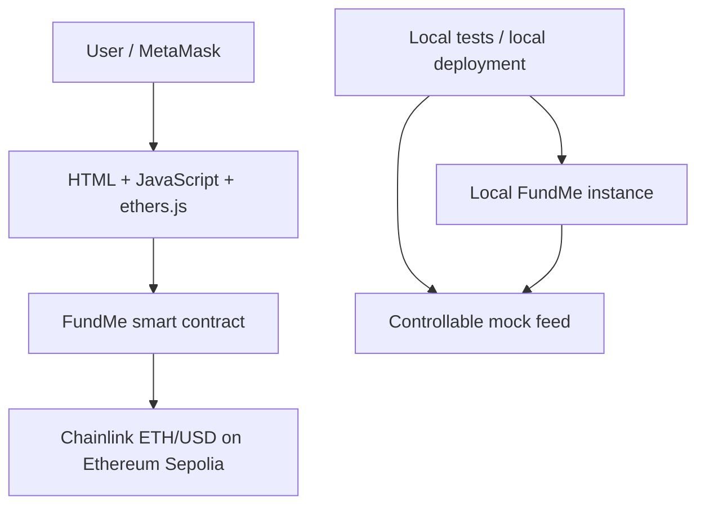

# FundMe

FundMe accepts ETH contributions worth **at least $2 USD**, using an on-chain Chainlink ETH/USD Data Feed. The immutable owner can withdraw all ETH. A small MetaMask frontend displays the price, balance, funding form, and owner controls.

**Implementation status:** project files have been created, but the full project has not yet been compiled or verified in this workspace. npm registry access and writable Git metadata are unavailable here. See [VALIDATION.md](VALIDATION.md) for the checks actually run and remaining blockers. No Sepolia deployment is claimed.

## Overview

This project teaches Solidity, oracle integration, exact integer arithmetic, deterministic tests, deployment, and wallet interaction. Contributions are donations to the owner: funders have no withdrawal or refund rights.

| Contribution value | Result |
| --- | --- |
| Less than $2, including $1.99 | Revert |
| Exactly $2.00 | Accept |
| More than $2, including $2.01, $10, and $1000 | Accept |

**There is no maximum contribution.** Gas is paid separately and is not counted toward the minimum.

## Architecture



On Sepolia, the contract reads the official Chainlink feed. On the local Hardhat network, it reads a mock whose price and timestamps tests can control. The frontend reads the deployed address and ABI from a generated JSON file; it contains no handwritten ABI.

## Features

- $2 minimum, inclusive at the boundary, with no maximum.
- Chainlink decimal normalization, positive price checks, round validation, and configurable staleness protection.
- Immutable owner and feed; owner-only withdrawal with safe ETH transfer and reentrancy protection.
- Lifetime contribution totals and one entry per unique funder.
- Funding and withdrawal events and custom errors.
- Local unit tests, deployment integration tests, frontend amount tests, and built-in Hardhat coverage.
- Local and Ethereum Sepolia deployment scripts, optional Ignition modules, and Etherscan verification configuration.
- Simple frontend with exact amount parsing, pending/confirmed/error states, network checks, and owner controls.

## Tech stack and version choices

| Component | Choice |
| --- | --- |
| Solidity | 0.8.28; Cancun EVM; optimizer enabled, 200 runs |
| Hardhat | 3.18.0; ESM configuration and `network.create()` |
| Tests | TypeScript, Mocha, Chai, Hardhat ethers matchers and fixtures |
| ethers.js | 6.15.0 |
| Oracle | `@chainlink/contracts` 1.4.0 official `AggregatorV3Interface` |
| Security/math | OpenZeppelin Contracts 5.4.0 `ReentrancyGuard` and `Math.mulDiv` |
| Environment | dotenv; lazy Hardhat configuration variables |
| Frontend | HTML, CSS, JavaScript, Vite, MetaMask |
| Networks | Hardhat local (31337), Ethereum Sepolia (11155111) |

The initial workspace had no installed Hardhat. The project uses the current Hardhat 3 API described in the [network manager documentation](https://hardhat.org/docs/reference/network-manager). It does not use Hardhat 2's ethers import or coverage plugin. The Solidity compiler is an npm dependency and configured by its local path, so subsequent builds do not download compilers.

## Requirements

- Linux, macOS, or Windows with a supported Node installation; keep Node and npm on the same platform when using WSL.
- Node.js 22.13+ on the 22 LTS line, or Node 24 LTS, and npm 10+.
- Git, a terminal, and an editor.
- Internet for the initial dependency installation. No RPC, wallet, or network access is required by local tests once dependencies are installed.
- For Sepolia only: an Ethereum Sepolia RPC endpoint, a dedicated testnet wallet with Sepolia ETH, and optionally an Etherscan API key.
- MetaMask for manual frontend interaction.

See [Hardhat prerequisites](https://hardhat.org/docs/getting-started) for the supported runtime requirements.

## Installation

Open a terminal in the repository root (the directory containing `package.json`). This workspace is named `FundMeTest`; a downloaded copy can have any directory name.

```bash
# If you use nvm:
nvm install
nvm use

node --version
npm --version
npm install
cp .env.example .env
```

No remote repository URL has been created for this project. If you publish it to GitHub, clone its actual URL and then run the same commands in the clone. Do not use a fictional example URL.

The first successful `npm install` creates `package-lock.json`. Commit that file, then use `npm ci` for reproducible subsequent installations. A lockfile could not be generated in the restricted authoring environment; it has not been fabricated. npm's peer dependencies install the compatible Hardhat toolbox plugins.

## Environment variables

`.env` stays local and is ignored by Git. `.env.example` contains blank values, not keys.

```dotenv
SEPOLIA_RPC_URL=
PRIVATE_KEY=
ETHERSCAN_API_KEY=
LOCAL_PRICE_FEED_ADDRESS=
FUNDME_ADDRESS=
```

| Variable | Purpose |
| --- | --- |
| `SEPOLIA_RPC_URL` | HTTPS RPC endpoint for **Ethereum Sepolia**, not another network |
| `PRIVATE_KEY` | `0x` followed by 64 hexadecimal characters for a dedicated testnet deployer; not a seed phrase |
| `ETHERSCAN_API_KEY` | Etherscan API v2 key, required only for Etherscan verification |
| `LOCAL_PRICE_FEED_ADDRESS` | Optional existing local mock address; otherwise local deployment creates a mock |
| `FUNDME_ADDRESS` | Existing deployed address used by the export and local oracle refresh scripts |

Local compilation and tests need none of these values. The Sepolia feed is fixed centrally in `config/networks.ts`; environment variables cannot silently replace it. No mainnet network is configured, and the script rejects chain IDs other than 31337 and 11155111.

Never use a production wallet key. Never put a private key or private RPC URL in frontend files, commit it, or share it in a screenshot. The frontend uses MetaMask's signer and never reads `.env`.

## Compile

```bash
npx hardhat compile
```

Compilation also generates ethers contract types. The official Chainlink interface is imported from its package rather than copied to `contracts/interfaces`; this avoids maintaining a duplicate interface. Test contracts live under `contracts/test` so Hardhat compiles them automatically; deployment scripts never select them on Sepolia.

## Run tests

```bash
npx hardhat test
npm run test:frontend
npm run typecheck
```

`typecheck` compiles first so generated contract types exist, then checks the TypeScript project and JavaScript frontend via `checkJs`.

To run the configured compile/test/typecheck/frontend-build checks together:

```bash
npm run check
```

## Test coverage

Hardhat 3 has [built-in coverage](https://hardhat.org/docs/guides/testing/code-coverage):

```bash
npx hardhat test --coverage
# Equivalent:
npm run coverage
```

Use this command instead of Hardhat 2's `npx hardhat coverage`. The report is generated under `coverage/`, including HTML and LCOV output. No percentage is claimed until the command has actually completed. Coverage changes gas consumption, so withdrawal tests use each transaction's measured receipt fee.

| Test file | Coverage intent |
| --- | --- |
| `test/FundMe.test.ts` | Deployment, owner/feed getters, decimals 0/6/8/18, unsupported decimals, price changes, exact USD boundaries, overflow-safe multiplication, contribution totals, duplicate/multiple funders, events, plain ETH transfers, unknown calldata |
| `test/Withdrawal.test.ts` | Access control, empty withdrawal, one/three funders, complete balance transfer, gas accounting, retained records, returning funders, oracle-independent withdrawal, failed receiver, reentrancy |
| `test/OracleFailures.test.ts` | Zero/negative/oversized prices, zero/future timestamps, incomplete rounds, exact staleness boundary, stale recovery, oracle reverts |
| `test/Deployment.integration.test.ts` | Real local deployment helper, generated ABI/config, funding and withdrawal through the exported ABI, local Ignition module, chain allowlist |
| `frontend/test/amounts.test.js` | Exact ETH parsing, malformed input, all required USD boundaries, ceil rounding, one-wei boundary checks, USD formatting |

## Local deployment

Terminal 1, from the project root:

```bash
npx hardhat node --network hardhat
```

Terminal 2:

```bash
npx hardhat run scripts/deploy.ts --network localhost
npm run frontend:dev
```

The deployment script creates an 8-decimal mock at **$2000/ETH**, deploys FundMe with a 3600-second timeout, and generates:

```text
deployments/31337.json
frontend/public/generated/deployment.json
```

Open `http://127.0.0.1:5173`. Add/select a local MetaMask network with RPC `http://127.0.0.1:8545`, chain ID `31337`, currency `ETH`. Use a separate development wallet profile and import one of the public test accounts printed by Hardhat. The first account deploys the contract and is its owner. A second account demonstrates non-owner funding and hidden withdrawal controls.

Hardhat's printed accounts are public, disposable test accounts. Never send real funds to them. Do not expose the local node publicly.

At the mock price, `0.001 ETH` meets the $2 minimum. Fund from one account and withdraw from the owner account. Restarting the local node erases deployments and balances; run the deployment script again and reload the frontend. If MetaMask retains a stale local nonce after a reset, clear the local account's activity in MetaMask's advanced settings.

The mock does not update by itself. After one hour of local chain time it becomes stale. Set the local `FUNDME_ADDRESS` in `.env`, then refresh the mock:

```bash
npx hardhat run scripts/refresh-local-price.ts --network localhost
```

For a disposable deployment that does not serve the frontend:

```bash
npx hardhat run scripts/deploy.ts --network hardhat
```

This in-process network disappears when the script finishes, so its address is intentionally not exported to the frontend.

## Sepolia deployment

1. Add your Ethereum Sepolia RPC URL and dedicated testnet private key to `.env`.
2. Obtain Sepolia ETH for that wallet from a suitable testnet faucet.
3. Run the tests and inspect the network settings.
4. Deploy with the production build profile:

```bash
npx hardhat run scripts/deploy.ts --network sepolia --build-profile production
# Equivalent:
npm run deploy:sepolia
```

The script checks the actual chain ID, uses the official feed, deploys from the configured wallet, validates a price read, and exports the deployed address/ABI. The output includes the contract address and public owner/feed addresses. No private key is printed by the script.

If the post-deployment oracle read fails, the deployment transaction may already have been mined. Check the deployer's transaction history before redeploying. The export script can recover the frontend configuration from an existing deployment.

Select Ethereum Sepolia in MetaMask and run `npm run frontend:dev`. Only the deployer's wallet sees the owner panel. This repository does not include a fabricated deployment address and does not claim to have broadcast a Sepolia transaction.

## Contract verification

Set `ETHERSCAN_API_KEY` in `.env`. Use the exact deployed address and the two constructor arguments: feed address, then max age in seconds.

```bash
npx hardhat verify --network sepolia --build-profile production <CONTRACT_ADDRESS> 0x694AA1769357215DE4FAC081bf1f309aDC325306 3600
```

Replace `<CONTRACT_ADDRESS>` with the actual output of deployment. The explicit `production` profile matches the recommended deployment command. If you deployed using the default profile, use `--build-profile default` consistently. Wait for explorer indexing before retrying verification. See the [Hardhat verification guide](https://hardhat.org/docs/guides/smart-contract-verification).

### Optional Ignition deployment

The script workflow above is the simplest because it automatically exports the frontend configuration. Ignition is also supported:

```bash
# Local, with a running node:
npx hardhat ignition deploy ignition/modules/LocalFundMe.ts --network localhost

# Ethereum Sepolia:
npx hardhat ignition deploy ignition/modules/FundMe.ts --network sepolia
```

Ignition retains deployment journals under `ignition/deployments/` for resuming a deployment. Keep these journals backed up for a real project. They are ignored here to avoid committing disposable local deployment state.

After an Ignition deployment, set `FUNDME_ADDRESS` to its deployed FundMe address in `.env` and generate the frontend configuration:

```bash
npx hardhat run scripts/export-frontend.ts --network localhost
# Or, for a Sepolia deployment:
npx hardhat run scripts/export-frontend.ts --network sepolia --build-profile production
```

Use the Sepolia module only on Sepolia and the local module only on the local node. No mainnet command or network is provided.

## Chainlink

Chainlink Data Feeds publish aggregated external data on-chain. The EVM knows the amount of ETH sent but does not inherently know its USD value; FundMe needs ETH/USD to enforce a dollar-denominated minimum. FundMe calls the feed directly; it does not call CoinGecko or an HTTP price API.

**Ethereum Sepolia ETH/USD:**

```text
0x694AA1769357215DE4FAC081bf1f309aDC325306
```

This address appears in runtime configuration only in `config/networks.ts`. See the official [Data Feeds API reference](https://docs.chain.link/data-feeds/api-reference) and [using Data Feeds guide](https://docs.chain.link/data-feeds/using-data-feeds).

`AggregatorV3Interface.latestRoundData()` returns `(roundId, answer, startedAt, updatedAt, answeredInRound)`. FundMe uses the answer and update time and rejects a zero round ID, an older answered round, nonpositive answers, missing/future update timestamps, and stale prices. `answeredInRound` is deprecated on modern feeds; the check remains a defensive condition for older implementations. A reverted oracle call propagates and funding fails closed.

`decimals()` tells consumers how many decimal places the raw answer uses. An 8-decimal answer of `200000000000` means $2000. This contract reads and caches decimals at deployment, supports 0 through 18, and explicitly rejects higher precision instead of silently truncating it. A feed whose decimals later change is outside this contract's assumptions; redeploy for such a migration.

The maximum price age is a constructor argument. Configuration chooses **3600 seconds (one hour)** for both Sepolia and local demonstrations. Exactly that age is accepted; an older price is rejected. This is a project policy, not a claim that every feed's heartbeat is one hour. Check the selected feed's heartbeat, update behavior, and risk requirements when choosing a timeout for another deployment. An update delay can temporarily stop funding. Withdrawal does not depend on the oracle.

## Price calculation

All monetary calculations use integers. ETH uses `10^18 wei` per ETH. FundMe represents USD with 18 decimal places too, so `MINIMUM_USD = 2e18` means $2, not 2 ETH.

For an oracle answer `A` with `d` decimals, where `0 <= d <= 18`:

```text
normalizedPrice = A × 10^(18 - d)          // USD per ETH, with 18 decimals
usdValue        = floor(weiAmount × normalizedPrice / 10^18)
accept          = usdValue >= 2 × 10^18
minimumWei      = ceil(2 × 10^18 × 10^18 / normalizedPrice)
```

Example:

```text
1 ETH = $2000
Chainlink answer (8 decimals) = 2000 × 10^8
Normalized price             = 2000 × 10^18

$2 / ($2000 per ETH) = 0.001 ETH
0.001 ETH = 1,000,000,000,000,000 wei

USD value = (10^15 × 2000 × 10^18) / 10^18
          = 2 × 10^18 USD units
          = $2.00 -> accept
```

At $2000/ETH, $1.99 is `0.000995 ETH`, $2.01 is `0.001005 ETH`, $10 is `0.005 ETH`, and $1000 is `0.5 ETH`.

`Math.mulDiv` avoids overflowing an intermediate multiplication when the final quotient fits in `uint256`. The USD calculation rounds down, which never makes an underpayment pass. At $3000/ETH, an exact $2 amount is not representable in integer wei: the smallest accepted amount is `666666666666667 wei`, and one wei less fails. `getMinimumContributionWei()` rounds upward accordingly. The frontend uses `bigint`, never floating-point numbers, for payment validation.

### Why the minimum is $2

The product requirement is a **minimum**, implemented as `if (usdValue < MINIMUM_USD) revert`. Equality is accepted. There is no upper-bound comparison. The oracle price at transaction execution is authoritative; a frontend quote can become outdated before mining. A small contribution buffer can help with price movement, but the frontend never increases the user's entered amount automatically.

## Smart contract functions

View calls below are free when invoked off-chain using `eth_call`; calling them from another transaction consumes gas. State-changing functions require a transaction and gas, including reverted transactions that are mined. No function transfers ownership or changes the feed.

| Function / getter | Parameters and return | Access and effects |
| --- | --- | --- |
| `constructor(priceFeed, maximumPriceAge)` | Feed address and nonzero timeout in seconds | Deployment sets immutable owner/feed/decimals/timeout; costs gas |
| `fund()` | Payable ETH amount via `msg.value`; no return | Anyone; validates price and minimum, updates lifetime records, emits `Funded`; costs gas |
| `receive()` | Empty calldata with ETH; no return | Anyone; calls `fund()` with the same checks; costs gas |
| `fallback()` | Unknown calldata | Always reverts with `FundMe__UnknownCall` |
| `withdraw()` | No parameters/return | Owner only; transfers complete balance, emits `Withdrawn`, preserves records; costs gas |
| `getPrice()` | Returns ETH/USD in 18-decimal USD units | Public view; validates oracle data |
| `getConversionRate(ethAmount)` | Wei amount; returns 18-decimal USD value rounded down | Public view; same oracle validation |
| `getMinimumContributionWei()` | Returns smallest currently accepted integer wei amount | External view; same oracle validation |
| `getPriceFeed()` | Returns configured feed address | External view |
| `getVersion()` | Returns feed interface version | External view; asks the configured feed |
| `getFunderCount()` | Returns number of lifetime unique funders | External view |
| `i_owner()` | Returns immutable owner address | Public generated view getter |
| `MINIMUM_USD()` | Returns `2000000000000000000` | Public generated constant getter |
| `maxPriceAge()` | Returns maximum accepted age in seconds | Public generated immutable getter |
| `feedDecimals()` | Returns cached feed precision | Public generated immutable getter |
| `addressToAmountFunded(funder)` | Address; returns lifetime contribution in wei | Public generated mapping getter; returns zero for unknown funders |
| `funders(index)` | Zero-based index; returns address | Public generated array getter; out-of-range access reverts |

The mapping and array already provide useful getters; duplicate aliases are intentionally omitted. `Funded(funder, amount, usdValue)` indexes the funder and records wei plus 18-decimal USD. `Withdrawn(owner, amount)` indexes the owner and records wei.

The test-only mock exposes `updateAnswer`, `setRoundData`, and `setShouldRevert` so tests can simulate fresh, invalid, stale, and unavailable data. These are unrestricted test controls and must never be substituted for a real oracle on a public deployment. `OwnerHarness` is also test-only.

## Withdrawal state and accounting

`addressToAmountFunded` and `funders` are **historical lifetime records**, not withdrawable balances. They are not reset. A funder who returns after withdrawal remains a single array entry, and their total continues increasing. Their recorded total can exceed the contract's present balance.

Withdrawal is constant-time with respect to the funder count, so many funders cannot create a cleanup-loop gas denial of service. Tests check:

```text
contract balance after = 0
owner balance after + transaction receipt fee - owner balance before
    = contract balance before
```

A contract owner that rejects ETH causes withdrawal to revert, keeping the funds in FundMe. The owner address cannot be replaced, so a permanently rejecting receiver or lost owner key can permanently lock funds.

## Security considerations

- **Access control:** only the immutable deployer withdraws. The frontend's owner panel is convenience; Solidity enforces authorization.
- **Reentrancy:** both funding and withdrawal use OpenZeppelin's storage-based guard. Withdrawal checks authorization and balance before a checked low-level `call`; receiver failure rolls back the transaction. A malicious owner receiver is tested.
- **Oracle trust:** a correct interface/address is necessary but is not a proof that a price is economically accurate. Fresh positive prices may still be incorrect or manipulated at the oracle layer. No extra deviation circuit breaker is implemented.
- **Staleness:** missing/future timestamps, stale rounds, and invalid prices reject funding. Choose timeout policy for the actual feed. Withdrawal remains available during oracle outages.
- **Decimals and precision:** only 0..18 decimal feeds are supported; normalization is exact. Oversized malformed answers are rejected. Solidity 0.8.28 checks arithmetic, and full-width `mulDiv` avoids premature multiplication overflow.
- **Direct ETH:** ordinary plain transfers use `receive()` and enforce the minimum. EVM mechanisms can force ETH into a contract without invoking its code. Forced ETH is withdrawable but does not create a `Funded` event or contribution record; it cannot be prevented by a receive function.
- **Storage growth:** unique funders remain forever, increasing historical storage. Withdrawal does not iterate through that history. Large history queries should use events or pagination outside this simple UI.
- **Immutability:** no upgrade, pause, owner transfer, refund, or feed migration mechanism exists. A changed owner/feed/timeout requires a new deployment and a new frontend export.
- **Private keys:** `.env` is ignored; use a dedicated testnet wallet. The frontend contains only public configuration. Do not host the project root as a static website.
- **Testnet versus mainnet:** Sepolia assets have no intended monetary value. Neither local tests nor passing coverage establish production safety. Obtain an independent audit before entrusting real value to a derivative of this contract.

## Testing strategy

All Hardhat test connections explicitly select the simulated `hardhat` network. They cannot silently become live Sepolia tests when a CLI network flag changes. Fixtures restore clean snapshots. Oracle time is manipulated on the simulated chain; tests do not sleep or depend on wall-clock timing.

The deployment integration test runs the actual deployment/export helper against a local EVM, checks generated JSON against the compiled ABI, and transacts through that exported ABI. It does not send public transactions or require keys. A manual Sepolia smoke test is a separate activity: deploy, open the frontend, fund with the current minimum, and withdraw using the owner wallet. Live amounts depend on the price at execution.

## Frontend

See [frontend/README.md](frontend/README.md) for the complete wallet workflow.

```bash
npm run frontend:dev
npm run frontend:build
npm run frontend:preview
```

Vite serves the frontend only. ethers is bundled from the installed package, not loaded from an unpinned CDN. Deployment exports a single ABI/config JSON into `frontend/public/generated/`; Vite copies it into the build. Re-export and rebuild when changing deployments. The last export chooses which network that frontend instance targets.

The UI handles user-rejected requests, insufficient funds, invalid input, wrong chains, missing deployments, stale prices, contract reverts, and pending/confirmed transactions. It shows full wallet/contract addresses, has accessible status text, and resets signer state on wallet account/network changes. An oracle outage disables funding while keeping eligible owner withdrawal controls available. The smart contract always makes the final minimum/authorization decision.

## Git history and commit strategy

The first Git command in this workspace was `git init`. It failed because the environment mounted `.git` read-only, so **no commits have been created**. This is a blocker, not an invented clean history. The stages correspond to these intended Conventional Commit subjects:

```text
chore: initialize hardhat project and network configuration
feat: implement oracle-backed fundme contract and local mocks
test: cover deployment pricing and contribution boundaries
test: cover owner withdrawals and oracle failures
feat: add deployment scripts and frontend artifact export
test: add local deployment integration tests
feat: add wallet funding and owner withdrawal frontend
test: validate frontend amount arithmetic
docs: explain setup deployment security and verification
```

Once Git metadata is writable, commit each logical file group independently; do not claim those commits predate the work. Then inspect the actual repository:

```bash
git status
git log --oneline --decorate --graph
```

## Project structure

```text
FundMeTest/
├── config/networks.ts
├── contracts/
│   ├── FundMe.sol
│   └── test/
│       ├── MockV3Aggregator.sol
│       └── OwnerHarness.sol
├── scripts/
│   ├── deploy.ts
│   ├── export-frontend.ts
│   ├── refresh-local-price.ts
│   └── lib/deployment.ts
├── ignition/modules/
│   ├── FundMe.ts
│   └── LocalFundMe.ts
├── test/
│   ├── helpers.ts
│   ├── FundMe.test.ts
│   ├── Withdrawal.test.ts
│   ├── OracleFailures.test.ts
│   └── Deployment.integration.test.ts
├── frontend/
│   ├── index.html
│   ├── src/{main.js,amounts.js,style.css,env.d.ts}
│   ├── test/amounts.test.js
│   ├── public/generated/deployment.json  (generated, ignored)
│   ├── tsconfig.json
│   ├── vite.config.js
│   └── README.md
├── .github/workflows/ci.yml
├── .env.example
├── .gitignore
├── .npmrc
├── .nvmrc
├── hardhat.config.ts
├── package.json
├── tsconfig.json
├── LICENSE
├── VALIDATION.md
└── README.md
```

## Common problems

| Problem | Resolution |
| --- | --- |
| `npm install` cannot resolve the registry | Restore DNS/network access to npm; do not substitute untrusted packages. Check that Linux Node is paired with Linux-compatible npm in WSL. |
| Unsupported Node version | Use `nvm install` / `nvm use` or install Node 22.13+ / 24 LTS. |
| RPC errors or wrong chain ID | Check `SEPOLIA_RPC_URL`, endpoint credentials, rate limits, and that it serves Ethereum Sepolia (11155111). |
| Insufficient Sepolia ETH | Fund the deployer/wallet with Sepolia ETH; leave enough for transaction gas. |
| Wrong network in MetaMask | Select the generated deployment's network; use the UI switch button or wallet network settings. |
| Feed address has no code | The RPC is on the wrong network or a local override is incorrect. Sepolia uses the exact centrally configured feed. |
| Oracle price is unavailable/stale | Wait for a fresh public feed update. Locally, use `refresh-local-price.ts` or redeploy the mock. |
| Invalid private key configuration | Supply a dedicated testnet private key in `.env`, prefixed with `0x`; never a wallet address or mnemonic. |
| Contract address mismatch / no code | Re-export from the correct network and actual deployed address. Restarted local chains need redeployment. |
| Frontend network mismatch after another deployment | The generated JSON targets the last exported network. Re-export the desired deployment, rebuild if needed, and reload. |
| `$2` quote reverts after submission | The price changed before execution. Refresh and enter an amount meeting the new minimum. |
| Verification fails | Match constructor arguments, compiler, and build profile; wait for explorer indexing. |
| TypeScript cannot find generated contract types | Run `npx hardhat compile` before `npm run typecheck`. |
| Git says read-only filesystem | Enable writable `.git` metadata in the workspace permission configuration; ordinary file edits do not fix a read-only mount. |

## Disclaimer

This is an educational project and has not been audited. Full contract compilation, tests, coverage, frontend build, and Git history are pending the environment fixes recorded in [VALIDATION.md](VALIDATION.md). Do not treat the code or passing frontend arithmetic tests as evidence that it is production-verified.
